

  <picture>
    <source media="(prefers-color-scheme: dark)" srcset="https://raw.githubusercontent.com/JasperPengC/JasperPengC/main/assets/hero.svg?v=20261118v2">
    <source media="(prefers-color-scheme: light)" srcset="https://raw.githubusercontent.com/JasperPengC/JasperPengC/main/assets/hero-light.svg?v=20261118v2">
    
  </picture>

<picture>
    <source media="(prefers-color-scheme: dark)" srcset="https://raw.githubusercontent.com/JasperPengC/JasperPengC/main/assets/divider-about.svg?v=20261118v2">
    <source media="(prefers-color-scheme: light)" srcset="https://raw.githubusercontent.com/JasperPengC/JasperPengC/main/assets/divider-about-light.svg?v=20261118v2">
    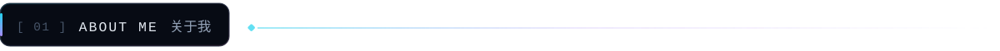
  </picture>

写的东西比较杂，从传统项目一路做到 AI 应用。广是挺广，精就谈不上了，慢慢补吧。

现在写代码基本靠 AI，我负责挑刺、改错、收尾。

*Pretty mixed bag — traditional projects all the way to AI applications. Wide, sure; deep, not so much. Filling in the gaps as I go.*

*These days AI writes most of the code; I do the nitpicking, fixing and finishing.*

<picture>
    <source media="(prefers-color-scheme: dark)" srcset="https://raw.githubusercontent.com/JasperPengC/JasperPengC/main/assets/divider-whatido.svg?v=20261118v2">
    <source media="(prefers-color-scheme: light)" srcset="https://raw.githubusercontent.com/JasperPengC/JasperPengC/main/assets/divider-whatido-light.svg?v=20261118v2">
    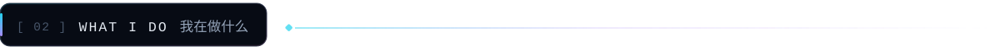
  </picture>

<picture>
    <source media="(prefers-color-scheme: dark)" srcset="https://raw.githubusercontent.com/JasperPengC/JasperPengC/main/assets/capability.svg?v=20261118v2">
    <source media="(prefers-color-scheme: light)" srcset="https://raw.githubusercontent.com/JasperPengC/JasperPengC/main/assets/capability-light.svg?v=20261118v2">
    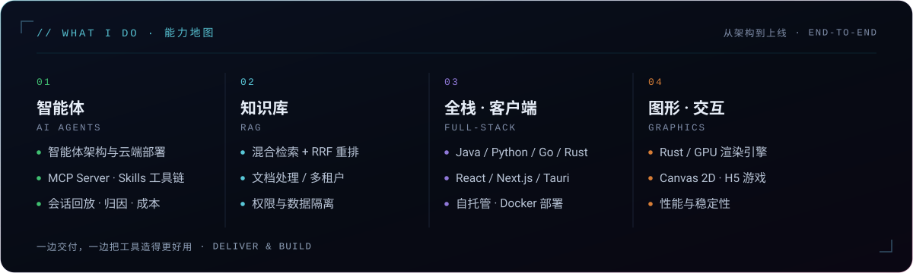
  </picture>

<picture>
    <source media="(prefers-color-scheme: dark)" srcset="https://raw.githubusercontent.com/JasperPengC/JasperPengC/main/assets/divider-opensource.svg?v=20261118v2">
    <source media="(prefers-color-scheme: light)" srcset="https://raw.githubusercontent.com/JasperPengC/JasperPengC/main/assets/divider-opensource-light.svg?v=20261118v2">
    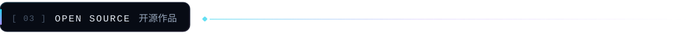
  </picture>

<table>
  <tr>
    <td align="center" width="50%">
      <a href="https://github.com/JasperPengC/feronavi"><picture>
              <source media="(prefers-color-scheme: dark)" srcset="https://raw.githubusercontent.com/JasperPengC/JasperPengC/main/assets/proj-feronavi.svg?v=20261118v2">
              <source media="(prefers-color-scheme: light)" srcset="https://raw.githubusercontent.com/JasperPengC/JasperPengC/main/assets/proj-feronavi-light.svg?v=20261118v2">
              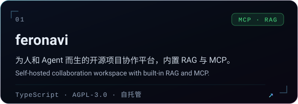
            </picture></a>
    </td>
    <td align="center" width="50%">
      <a href="https://github.com/JasperPengC/PP-Clash"><picture>
              <source media="(prefers-color-scheme: dark)" srcset="https://raw.githubusercontent.com/JasperPengC/JasperPengC/main/assets/proj-pp-clash.svg?v=20261118v2">
              <source media="(prefers-color-scheme: light)" srcset="https://raw.githubusercontent.com/JasperPengC/JasperPengC/main/assets/proj-pp-clash-light.svg?v=20261118v2">
              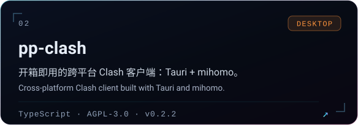
            </picture></a>
    </td>
  </tr>
  <tr>
    <td align="center" width="50%">
      <a href="https://github.com/JasperPengC/marble-wreckers"><picture>
              <source media="(prefers-color-scheme: dark)" srcset="https://raw.githubusercontent.com/JasperPengC/JasperPengC/main/assets/proj-marble-wreckers.svg?v=20261118v2">
              <source media="(prefers-color-scheme: light)" srcset="https://raw.githubusercontent.com/JasperPengC/JasperPengC/main/assets/proj-marble-wreckers-light.svg?v=20261118v2">
              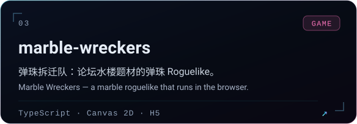
            </picture></a>
    </td>
    <td align="center" width="50%">
      <a href="https://github.com/JasperPengC/agent-blackbox"><picture>
              <source media="(prefers-color-scheme: dark)" srcset="https://raw.githubusercontent.com/JasperPengC/JasperPengC/main/assets/proj-agent-blackbox.svg?v=20261118v2">
              <source media="(prefers-color-scheme: light)" srcset="https://raw.githubusercontent.com/JasperPengC/JasperPengC/main/assets/proj-agent-blackbox-light.svg?v=20261118v2">
              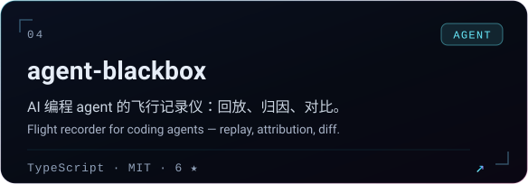
            </picture></a>
    </td>
  </tr>
  <tr>
    <td align="center" width="50%">
      <a href="https://github.com/JasperPengC/dsh-mcp-skills-board"><picture>
              <source media="(prefers-color-scheme: dark)" srcset="https://raw.githubusercontent.com/JasperPengC/JasperPengC/main/assets/proj-dsh-mcp-skills-board.svg?v=20261118v2">
              <source media="(prefers-color-scheme: light)" srcset="https://raw.githubusercontent.com/JasperPengC/JasperPengC/main/assets/proj-dsh-mcp-skills-board-light.svg?v=20261118v2">
              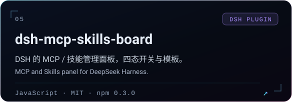
            </picture></a>
    </td>
    <td align="center" width="50%">
      <a href="https://github.com/JasperPengC/dsh-agent-blackbox"><picture>
              <source media="(prefers-color-scheme: dark)" srcset="https://raw.githubusercontent.com/JasperPengC/JasperPengC/main/assets/proj-dsh-agent-blackbox.svg?v=20261118v2">
              <source media="(prefers-color-scheme: light)" srcset="https://raw.githubusercontent.com/JasperPengC/JasperPengC/main/assets/proj-dsh-agent-blackbox-light.svg?v=20261118v2">
              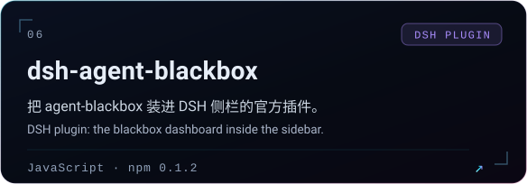
            </picture></a>
    </td>
  </tr>
</table>

上面 6 个是公开的原创仓库（<code>PP-Clash</code> 另有 macOS / Windows / Linux 安装包）· 上游 fork 仅作收藏，不在此列出 · 更多见 <a href="https://github.com/JasperPengC?tab=repositories">repositories</a>

<picture>
    <source media="(prefers-color-scheme: dark)" srcset="https://raw.githubusercontent.com/JasperPengC/JasperPengC/main/assets/divider-stack.svg?v=20261118v2">
    <source media="(prefers-color-scheme: light)" srcset="https://raw.githubusercontent.com/JasperPengC/JasperPengC/main/assets/divider-stack-light.svg?v=20261118v2">
    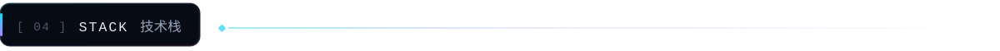
  </picture>

<picture>
    <source media="(prefers-color-scheme: dark)" srcset="https://raw.githubusercontent.com/JasperPengC/JasperPengC/main/assets/stack.svg?v=20261118v2">
    <source media="(prefers-color-scheme: light)" srcset="https://raw.githubusercontent.com/JasperPengC/JasperPengC/main/assets/stack-light.svg?v=20261118v2">
    
  </picture>

<picture>
    <source media="(prefers-color-scheme: dark)" srcset="https://raw.githubusercontent.com/JasperPengC/JasperPengC/main/assets/stack-matrix.svg?v=20261118v2">
    <source media="(prefers-color-scheme: light)" srcset="https://raw.githubusercontent.com/JasperPengC/JasperPengC/main/assets/stack-matrix-light.svg?v=20261118v2">
    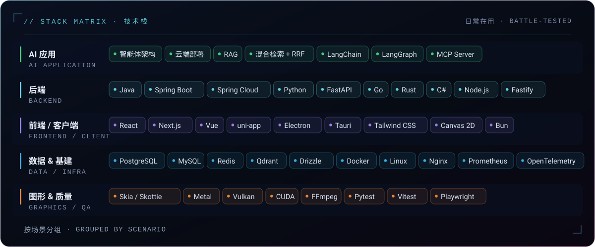
  </picture>

<picture>
    <source media="(prefers-color-scheme: dark)" srcset="https://raw.githubusercontent.com/JasperPengC/JasperPengC/main/assets/divider-connect.svg?v=20261118v2">
    <source media="(prefers-color-scheme: light)" srcset="https://raw.githubusercontent.com/JasperPengC/JasperPengC/main/assets/divider-connect-light.svg?v=20261118v2">
    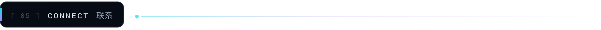
  </picture>

  
  
  

📮 <a href="mailto:cyp_95@foxmail.com">cyp_95@foxmail.com</a> ｜ 想聊技术或产品，或是有合适的机会，欢迎来信，简历可邮件索取。

  <picture>
    <source media="(prefers-color-scheme: dark)" srcset="https://raw.githubusercontent.com/JasperPengC/JasperPengC/main/assets/footer.svg?v=20261118v2">
    <source media="(prefers-color-scheme: light)" srcset="https://raw.githubusercontent.com/JasperPengC/JasperPengC/main/assets/footer-light.svg?v=20261118v2">
    
  </picture>

<!-- 视觉资产由 tools/gen_assets.py 生成 · hand-built SVGs, no templates -->
